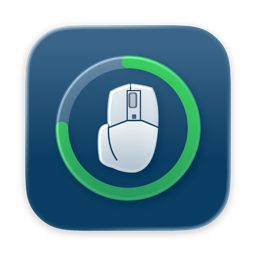
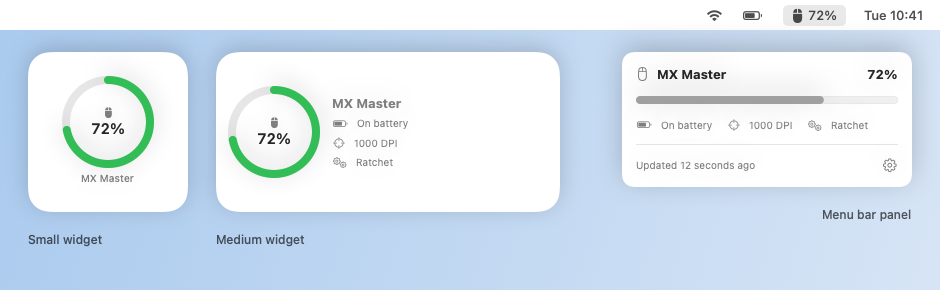
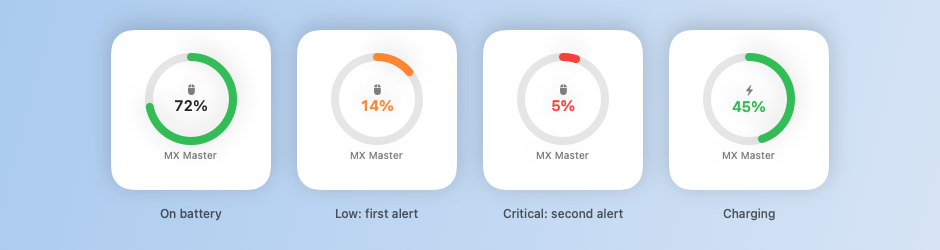

<p align="center">
  
</p>

<h1 align="center">LogiBar</h1>

<p align="center">
  <strong>Your Logitech mouse's battery, always in sight on your Mac.</strong><br>
  In the menu bar, in a desktop widget, and with an alert before it runs flat.
</p>

<p align="center">
  <a href="https://github.com/y0uknoWstuff/LogiBar/releases/latest"></a>
  
  
  <a href="LICENSE"></a>
</p>

<p align="center">
  <picture>
    <source media="(prefers-color-scheme: dark)" srcset="docs/images/overview-dark.png">
    
  </picture>
</p>

## What it does

- 🖱️ **Battery in the menu bar.** The percentage is always visible; click it for the details.
- 🧩 **Desktop and Notification Center widget**, in two sizes. The medium one also shows the
  pointer speed (DPI) and whether the scroll wheel is in free spin or ratchet mode.
- 🔔 **Low-battery alerts** at the level you choose (15% by default), and a last one at 5%.
  They reset as soon as you charge.
- ⚡ **Charging state** at a glance, with colours that go from green to orange to red.
- 🔒 **Private by design.** No internet connection, no accounts, no data collected.
- 🇬🇧 🇮🇹 English and Italian.

<p align="center">
  <picture>
    <source media="(prefers-color-scheme: dark)" srcset="docs/images/states-dark.png">
    
  </picture>
</p>

## What you need

| | |
|---|---|
| **Mac** | macOS 14 Sonoma or later, Apple silicon or Intel |
| **[OpenLogi](https://github.com/aprilnea/openlogi)** | Installed and running. It's the free, open-source app that talks to Logitech devices; LogiBar reads the battery through it. |
| **Mouse** | A Logitech mouse that OpenLogi recognises. Tested with the original **MX Master** on a Unifying receiver. |

LogiBar does not replace OpenLogi and does not need Logitech Options+.

## Get started

1. **Install OpenLogi.** Download it from [its releases page](https://github.com/aprilnea/openlogi/releases),
   open it and grant the permissions it asks for. Check that your mouse shows up in OpenLogi
   with its battery level.
2. **Install LogiBar.** Download `LogiBar-<version>.dmg` from the
   [latest release](https://github.com/y0uknoWstuff/LogiBar/releases/latest), open it and drag
   **LogiBar** onto **Applications**.
3. **Open LogiBar** from Applications. macOS asks whether to open an app downloaded from the
   internet: choose **Open**. The mouse and its percentage appear in the menu bar.
4. **Allow notifications** when asked, so the low-battery alerts can reach you.
5. **Add the widget.** Right-click the desktop → **Edit Widgets…** → search for **LogiBar** →
   drag the small or medium widget where you like.
6. **Set it up** (optional). Click the menu bar item → ⚙️ → **Settings…** to choose the alert
   level and turn on **Open at login**, so the widget stays up to date after a restart.

LogiBar has to keep running for the menu bar and the widget to update: it has no Dock icon and
lives only in the menu bar.

## Troubleshooting

<details>
<summary><strong>“OpenLogi is not running” or “OpenLogi is not installed”</strong></summary>

Open OpenLogi (the button in LogiBar's panel does it for you), or install it from
[its releases page](https://github.com/aprilnea/openlogi/releases). LogiBar looks for it in
Applications.
</details>

<details>
<summary><strong>“OpenLogi could not be verified”</strong></summary>

LogiBar only runs an OpenLogi signed by its developer, so a modified or fake copy can't use it.
Reinstall OpenLogi from its official releases page.
</details>

<details>
<summary><strong>The widget says “Open LogiBar”</strong></summary>

The widget shows data from the last 10 minutes only. Open LogiBar and turn on
**Open at login** in its settings.
</details>

<details>
<summary><strong>The widget is blank after an update</strong></summary>

Remove the widget and add it again, or log out and back in. macOS can keep the old widget
running for a while.
</details>

<details>
<summary><strong>My mouse is missing or shows “Offline”</strong></summary>

LogiBar shows what OpenLogi sees. Make sure the mouse is switched on, connected to this Mac
(check the Easy-Switch channel) and listed in OpenLogi.
</details>

<details>
<summary><strong>No low-battery notifications</strong></summary>

Check **System Settings → Notifications → LogiBar**. Alerts come once per level and reset only
after the mouse has charged above your threshold.
</details>

## Privacy and security

- **No network access**: LogiBar never connects to the internet and collects nothing.
- **Hands off the hardware**: it never talks to the mouse directly. It only reads OpenLogi's
  documented JSON interface (`openlogi api`), so OpenLogi stays the only app driving the device.
- **Checks what it runs**: before calling OpenLogi, LogiBar verifies it is signed by OpenLogi's
  developer.
- **Sandboxed widget**: the widget can only read the last reading LogiBar saved for it.
- **Signed and notarized**: every release is signed with Developer ID and notarized by Apple. Each
  release lists the DMG's SHA-256, so you can check your download with
  `shasum -a 256 LogiBar-<version>.dmg`.

<details>
<summary><strong>How it works</strong></summary>

```
OpenLogi agent ──(HID++)── mouse
      │
      │  openlogi api devices / dpi / smartshift   (JSON, schema_version 1)
      ▼
LogiBar.app  (menu bar)
  · asks OpenLogi every 30 s, the wheel and DPI every 5 min or when the panel opens
  · sends the low-battery notifications
  · saves the reading to a shared container and refreshes the widget when it changes
      ▼
LogiBar widget  (WidgetKit, sandboxed)
  · only reads the saved reading
```

</details>

## Build from source

You need Xcode and [XcodeGen](https://github.com/yonaskolb/XcodeGen) (`brew install xcodegen`).

```sh
cp Local.xcconfig.example Local.xcconfig   # put your Apple team ID in it (Xcode → Settings → Accounts)
tools/install.sh                           # builds, installs in /Applications, restarts the app and its widget
```

- `tools/release.sh` builds a signed, notarized `dist/LogiBar-<version>.dmg`. It needs a Developer
  ID Application certificate and notary credentials stored with
  `xcrun notarytool store-credentials logibar --apple-id <id> --team-id <team>`.
- `tools/screenshots/render.sh` regenerates the images above from the app's own views.

## Credits

LogiBar is built on top of [OpenLogi](https://github.com/aprilnea/openlogi) by AprilNEA, which does
all the work of talking to Logitech hardware.

LogiBar is an independent project, not affiliated with or endorsed by Logitech. Logitech and
MX Master are trademarks of Logitech.

## License

[MIT](LICENSE)
